  
  
  

### Hey, I'm Tahmid.

**Full-stack developer. Research-minded builder. Curious about what connects things.**

I'm a CSE undergraduate at **Ahsanullah University of Science and Technology**, based in **Dhaka, Bangladesh**. I build web and mobile experiences, work with APIs and data, and explore applied research in **IoT, embedded networking, and low-power communication**.

The interesting part for me is often the space between disciplines: a sensor that talks to a service, a backend that makes an interface useful, or a small tool that takes friction out of someone’s day.

 

<table>
<tr><td width="33%"><strong>⌘ SOFTWARE</strong>  Thoughtful interfaces, practical APIs, persistent data. Full-stack web · Mobile · Developer tools</td><td width="33%"><strong>⌁ SYSTEMS</strong>  Sensing, microcontrollers and communication beyond the browser. IoT · LoRa / LoRaWAN · Embedded networks</td><td width="33%"><strong>↗ PEOPLE</strong>  Building communities, mentoring and learning together. TechNetics · AUST Robotics Club</td></tr>
</table>

### The toolkit

### A little less README. A little more play.

The contribution snake runs directly here as an animation. The grid is generated from my GitHub activity.

<strong>⌁ Research notebook</strong>

My interests connect **sensing, microcontrollers, edge devices, wireless sensor networks and protocol design**. I’m exploring applied IoT and LoRa-based communication, with an interest in reliable systems beyond conventional web applications.

- **AUST Student Research Grant — Fall 2024 awardee**
- Manuscript in preparation; publication links will be added when available.
- [Research on my portfolio](https://tahmidkhan.com.bd/research) · [ORCID](https://orcid.org/0009-0009-5134-128X)

<strong>↗ Community, leadership & milestones</strong>

- **Founder, TechNetics** — organized CodEmpire 1.0 and TechEmpire 1.0.
- **Director, RnD Team, AUST Robotics Club** — engineering projects, technical events and mentoring Robotics Bootcamp 101 in 2024 and 2025.
- **AUST CSE Carnival 6.0 Hackathon** — finalist.
- **AUST CSE Carnival 3.0 IAPC** — finalist.
- **Meta Hacker Cup 2025** — regional round.
- **BYLC BBLT 45** graduate and BGN member.

[More background and credentials ↗](https://tahmidkhan.com.bd/credentials)

<strong>⌘ Open the project drawer</strong>

A few places where these interests turn into working code:

| Area | Explore |
| --- | --- |
| Systems & telemetry | [OfficePulse](https://github.com/tahmidkhanshuvo/OfficePulse) |
| Developer tools & experimentation | [CLite](https://github.com/tahmidkhanshuvo/CLite) · [IEEE Research Suite](https://github.com/tahmidkhanshuvo/IEEE-Research-Suite) · [Data Bot](https://github.com/tahmidkhanshuvo/Data-Bot) |
| Full-stack applications | [Green Gadgets](https://github.com/tahmidkhanshuvo/Green-Gadgets) · [SnackBox](https://github.com/tahmidkhanshuvo/SnackBox) · [Eventify](https://github.com/tahmidkhanshuvo/Eventify) · [CinemaGo](https://github.com/tahmidkhanshuvo/CinemaGo) |
| Mobile | [TekVend](https://github.com/tahmidkhanshuvo/TekVend) |

[Browse everything ↗](https://github.com/tahmidkhanshuvo?tab=repositories)

### Let's connect ideas.

I’m interested in software engineering, applied systems research, and collaborations where learning and building happen together.

**[Portfolio ↗](https://tahmidkhan.com.bd) &nbsp; [LinkedIn ↗](https://www.linkedin.com/in/tahmid-khan-shuvo) &nbsp; [Email ↗](mailto:hi@tahmidkhan.com.bd)**

Software, networks & physical systems. Always something new to connect.
